# FNO vs. MUSIC Particlization Investigation (30-40% centrality)

Log of setting up a Cooper-Frye (iSS) particlization comparison between live
`FnoHydro` and standard `MpiMusic`, finding and fixing a real bug in the
process, and then chasing down a smaller residual discrepancy. Kept as a
record of what's confirmed vs. still open, since the residual effect is not
fully explained.

## Pipeline

Both `fnoHydroLiveTest3D.cc` and `standardHydroLiveTest3D.cc` now wire up
`iSpectraSamplerWrapper` (iSS) and a `JetScapeWriterFinalStateHadronsAscii`
writer (flat `index pid pstat E px py pz` per event, alongside the full
event-record writer) — see commit `698378f`. Matched-seed (424242),
30-40%-centrality configs: `config/particlization_investigation/fno_3d_particlization_30_40_{fno,music}.xml`.
`contribs/FnoHydro/example/compare_particle_spectra.py` (PyROOT) builds pT and
rapidity spectra from the two drivers' output; it auto-detects event count per
file and accepts different `<SoftParticlization><iSS><number_of_repeated_sampling>`
values per arm.

## Bug found and fixed: velocity channels hardcoded to zero

**Symptom**: FNO's sampled-hadron rapidity spectrum showed a sharp spike at
y≈0 (more than 2x MUSIC's local plateau value), falling to ~zero by
|y|≈1.5-2, instead of MUSIC's broad, flat-ish distribution extending to
|y|≈3.

**Root cause**: `EvolveHydro()`'s FNO input-tensor construction hardcoded the
velocity channels (vx, vy, vz) to 0 for every cell, regardless of the
pre-equilibrium module in use — only energy density took the real primed
MUSIC snapshot. Real heavy-ion collisions already have substantial
Bjorken-like longitudinal flow (vz ≈ tanh(eta)) at tau0, so this was a
significant out-of-training-distribution input specifically for the velocity
channels. Confirmed via a dedicated diagnostic (`WriteEtaProfileDiagnostics`,
dumping the model's predicted vz per eta bin across tau): the model's
predicted vz never developed the correct monotonic-with-eta profile and
stayed far below the ~tanh(eta) magnitude real flow would reach at the grid
edges.

**Fix** (commit `fcb352b`): read `pre_eq_ptr->ux_/uy_/ueta_` (already
populated by `MusicPrimedPreEq` from the primer MUSIC's real `GetHydroInfo()`
snapshot, in the same raw-3-velocity convention FnoHydro's own output
channels use) instead of hardcoding 0. Safe no-op for `NullPreDynamics`,
which populates the same arrays with 0.

**Result**: post-fix, vz closely tracks real Bjorken flow (≈0.81-0.84 at
eta=1.3, vs tanh(1.3)≈0.86 expected), smoothly antisymmetric and stable
across tau. The dramatic rapidity spike is gone; FNO's rapidity spectrum is
now a smooth, broad, MUSIC-like shape.

## Residual: a ~13-14% central-rapidity peak, confirmed real

The bulk hydro field itself does not produce this peak at any stage of the
evolution -- it stays smooth in eta throughout:

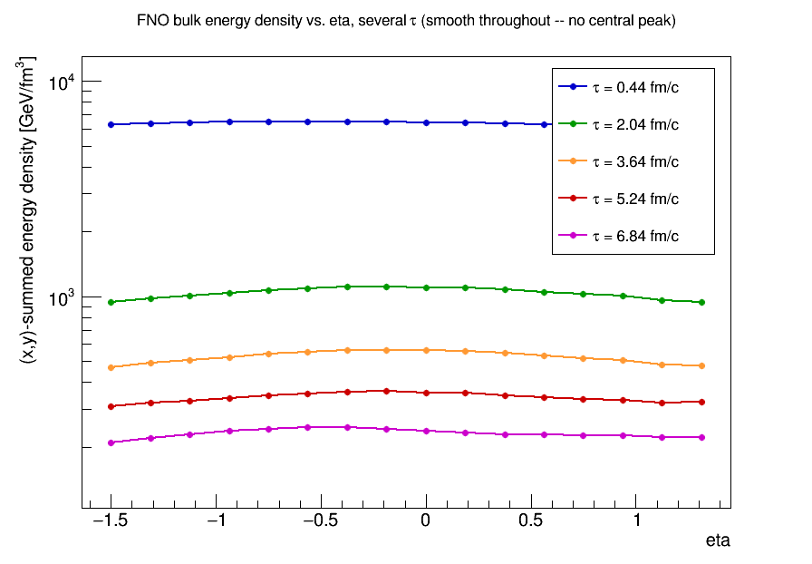

Real MUSIC (same seed, same event) shows the same character -- smooth across
the whole populated eta range, falling off only at the genuine edges of the
fireball (|eta| ≳ 5), with no central feature at any tau either:

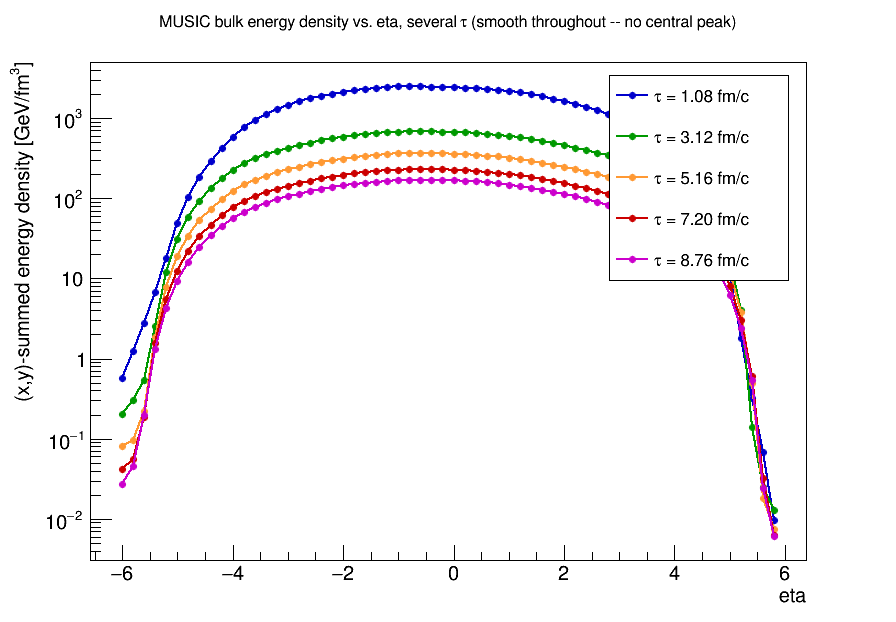

That is a genuinely different shape from the final, Cooper-Frye-sampled
hadron rapidity spectrum (15-FNO-event / 5-MUSIC-event ensemble), which does
show a real, localized peak at y≈0 for FNO:

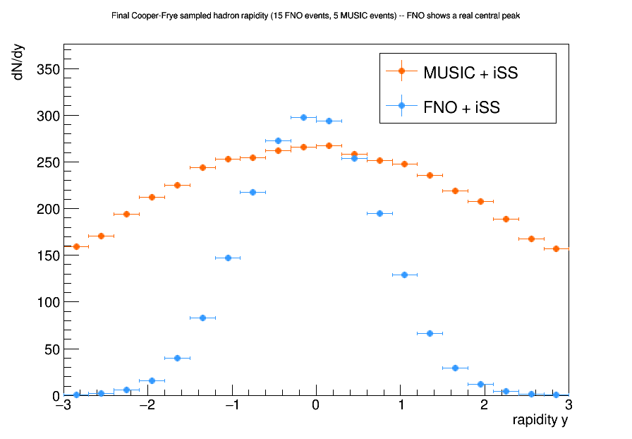

The mid-rapidity (|y|<1) pT spectrum from the same ensemble shows no
corresponding shape anomaly -- FNO tracks MUSIC's slope and normalization
closely (the peak is strictly a rapidity-direction effect, not a
pT-direction one):

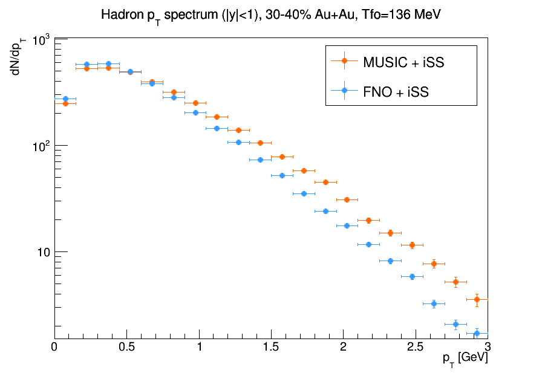

(Plotted with `example/plot_eta_evolution.py <eta_profile.csv> [out.png] [label]`,
`example/plot_final_peak.py <spectra_comparison.root>` (rapidity), and
`example/plot_pt_peak.py <spectra_comparison.root>` (pT) respectively --
rerun against fresh diagnostic output to regenerate or extend these. The
MUSIC-side CSV comes from `MusicWrapper.cc`'s `WriteMusicEtaProfileDiagnostic`
in the main X-SCAPE repo, which writes the same column format so the same
script works against either unchanged.)

The contrast between these two plots is the core evidence that the peak is
introduced at the freeze-out-surface / Cooper-Frye-sampling stage, not
inherited from the bulk evolution.

Even after the fix, FNO's rapidity spectrum is not perfectly flat at
midrapidity the way MUSIC's ensemble-averaged spectrum is — it shows a mild,
statistically robust central peak.

**Ruled out as the cause** (each checked directly):
- Raw energy-density field: flat/smooth in eta at every tau step, from the
  initial condition through near-freeze-out (checked across 4+ events) —
  only a persistent, *monotonic* ~10% one-sided slope inherited from each
  event's own fluctuating initial state, present unchanged in character from
  k=0 through k=64 (just declining in magnitude with expansion). This is
  ordinary event-by-event fluctuation, not a localized peak, and a
  structurally different shape from the final rapidity peak.
- Freeze-out surface cell count: flat across eta (~2% variation, interior
  bins).
- Species dependence: pion and proton show nearly identical peaking
  (~7.6-7.8%) in iSS's own per-cell analytic Cooper-Frye yield — ruled out
  "heavier particles show stronger flow modulation" as an explanation.

**Confirmed real** (not a statistics or binning artifact):
- The freeze-out surface's proper rest-frame volume element
  (`d3sigma_mu * u^mu`, not just the raw `|d3sigma_mu[0]|`) peaks at
  eta≈0 and declines ~5-8% by |eta|≈0.4 within a narrow window — a genuine,
  modest feature of the surface geometry.
- iSS's actual per-cell yield calculation (`FSSW::calculate_dN_dxtdy_for_one_particle_species`,
  the real runtime path at `MC_sampling=4`, not `EmissionFunctionArray` which
  isn't exercised by the default config) reproduces this: no hidden
  amplification between the analytic yield and the MC-sampled output for a
  single event.
- Checked individually across all 15 events of a larger ensemble run: every
  event shows a peak-to-edge ratio of 1.04-1.24 (mean ~1.14, i.e. ~14%) in
  the final sampled rapidity histogram — consistent across events, not an
  outlier in any one of them. (A single-event check during the investigation
  initially seemed to show only ~8%; that turned out to be a bin-reference
  calculation mistake, not a real discrepancy between events — recomputed
  correctly, that same event is fully consistent with the rest.)
- Running 3x more statistics (15 events vs. 5) did **not** flatten the peak
  — it stayed at essentially the same ~13-14% size, just with much smaller
  error bars. This rules out "it's noise that averages away."

**Partially confirmed, mechanism still open**: a per-eta-slice freeze-out
timing diagnostic (`WriteEtaFreezeoutApproachDiagnostic`) shows real,
eta-dependent structure in *when* and *how fast* each eta slice crosses its
own local freeze-out threshold — e.g. in one event, the center crosses one
time-step later than the edges, and cools 2-3x faster right at its own
crossing than the edges do at theirs. This confirms the model's dynamics
really do behave differently near freeze-out as a function of eta (plausibly
related to uneven training exposure from per-event, not per-cell,
truncation/padding of training targets), matching the user's hypothesis in
spirit.

However, the *direction* doesn't trivially close the loop: standard
Cooper-Frye intuition says *slower* local cooling gives a *larger* effective
surface element, which would predict the edges (slow cooling in the checked
event) should dominate — the opposite of the measured center-peaked
`dsigma_mu*u^mu`. The likely explanation is that this simple 1D
(per-eta, temporal-only) slope metric is too simple: the real surface
element is a genuinely 4D geometric quantity (via the Cornelius-style
`SurfaceFinder`/`FSSW` hypersurface construction), depending on spatial
gradients between neighboring x/y/eta cells too, not just the local time
derivative at fixed position. Fully closing this would mean replicating or
instrumenting that 4D construction directly — not done here.

## Cross-check: does the peak persist at a different centrality?

Repeated the same matched-seed (424242) comparison at 10-20% centrality
(`config/particlization_investigation/fno_3d_particlization_10_20_{fno,music}.xml`, single event only, not
yet run as an ensemble). Same signature: within a narrow mid-rapidity window
the FNO/MUSIC ratio rises from the edges toward center then falls back
(0.79 / 0.91 / 0.95 / 0.94 / 0.84 / 0.65 bin-by-bin), an ~11% local peak
relative to its own edges -- consistent in both direction and rough
magnitude with the ~13-14% found at 30-40%. The effect is not specific to one
centrality bin.

## Parameter study: raising the freeze-out temperature (136 -> 150 MeV)

Motivation: training targets are truncated/padded once an event approaches
its own freeze-out, so the model's supervision is weakest right at the low
end of the freeze-out-temperature range it was trained on. If that's
contributing to the peak, stopping the evolution earlier (a *higher*
freeze-out temperature, further from that undertrained regime) should reduce
it.

**This turned out not to be a hypothetical "higher than usual" value to try --
it's the model's actual training cutoff.** Checked all 18 training-data XML
configs under `/home/cparker/jetscape-docker/xmls/` (every centrality bin:
0-10, 10-20, 20-30, 30-40, including the "withT" and "finegrid" variants):
**none of them override `freezeout_temperature`** in their `<Hydro><MUSIC>`
block, so every one of them silently inherited `jetscape_main.xml`'s MUSIC
default of **0.150 GeV**. Separately, that same `jetscape_main.xml` also
defines independent `<FNO>`/`<FNOROOIN>` module defaults of **0.136 GeV**
(js-contrib's own FnoHydro defaults) -- a plausible-looking Cooper-Frye
literature convention that nothing ever cross-checked against what the
training data was actually generated with. Every live-inference config built
during this investigation (including all of this document's earlier
sections) explicitly used 0.136, following that second, unrelated
convention. So the entire original training dataset, across every
centrality bin, has real (non-padded) MUSIC targets only down to 150 MeV --
and every comparison run before this parameter study had been asking the
model to extrapolate ~14 MeV past where it actually had training
supervision, the whole time.

Tested with `config/particlization_investigation/fno_3d_particlization_30_40_{fno,music}_Tfo150.xml` --
siblings of the baseline 30-40% configs with `freezeout_temperature` raised
from 0.136 to 0.150 GeV in both the `<FNO>` block and the embedded priming
`<MUSIC>` block (FNO config), and the `<MUSIC>` block (MUSIC config).

**Same-event check** (seed 424242, nEvents=1, only Tfo changed -- a clean
A/B test with no event-to-event noise):

| window | Tfo=136 MeV | Tfo=150 MeV |
|---|---|---|
| peak/edge, narrow (\|y\|<0.45) | 1.124 (12.4%) | 1.076 (7.6%) |
| peak/edge, wide (\|y\|<0.75) | 1.388 (38.8%) | 1.230 (23.0%) |

**Ensemble check** (15 FNO events / 5 MUSIC events, matching the baseline
ensemble sizes; bin errors <1%, so this is statistically solid, not noise):

| window | Tfo=136 MeV (15-event) | Tfo=150 MeV (15-event) |
|---|---|---|
| peak/edge, narrow (\|y\|<0.45) | 1.131 (13.1%) | 1.091 (9.1%) |
| peak/edge, wide (\|y\|<0.75) | 1.440 (44.0%) | 1.239 (23.9%) |

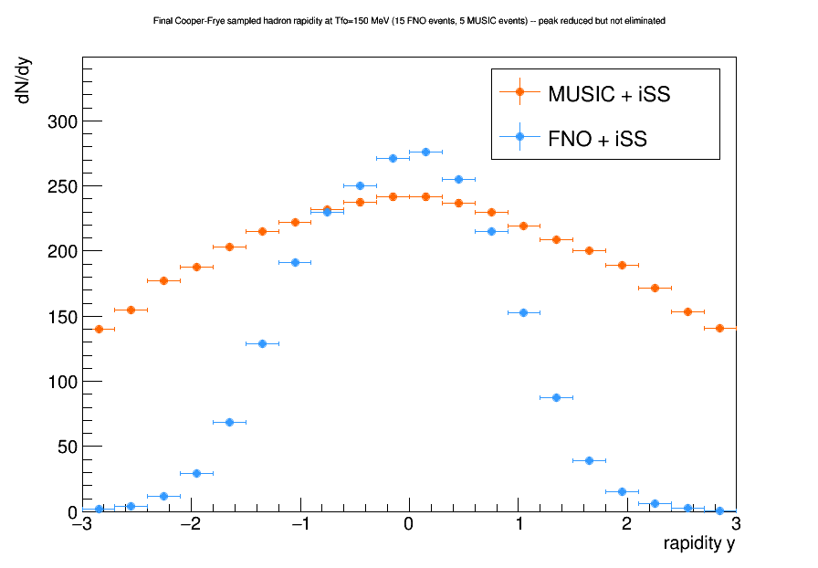

Mid-rapidity (|y|<1) pT spectrum, same ensemble -- still a close
slope/normalization match, unaffected by the Tfo change (as expected, since
Tfo only shifts the rapidity-direction shape, not pT):

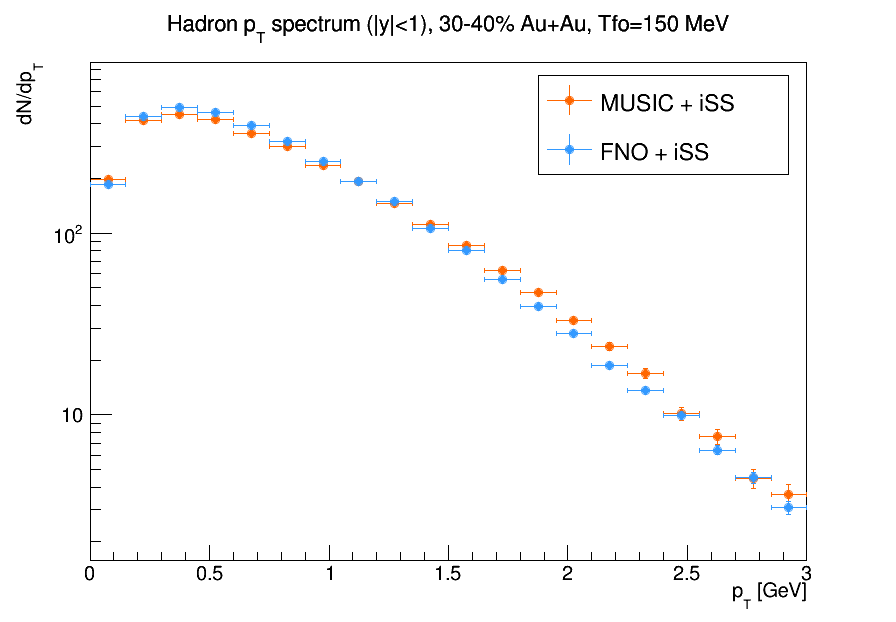

**Conclusion**: raising the freeze-out temperature meaningfully *shrinks* the
central peak -- roughly a 30% relative reduction in the narrow window, ~46%
in the wider one, confirmed at both single-event and ensemble level -- but
does **not** eliminate it; a real ~9-24% peak remains even at 150 MeV, i.e.
even running exactly at the model's real training cutoff rather than below
it. That residual is real evidence the training-truncation hypothesis is
only a partial explanation, not the whole mechanism -- plausibly because
individual training *events* still stop at different actual tau/temperature
(each event's own MUSIC run exits once its own hottest cell crosses 150 MeV,
so shorter-lived events contribute fewer late-time examples than
longer-lived ones), leaving uneven exposure even at the nominal cutoff
itself. See the testbed section below for a more direct attempt at closing
this gap entirely. As expected, raising
Tfo also reduces total yield since the evolution stops earlier (a smaller,
earlier freeze-out surface) -- only the *shape*/peak-ratio was compared
between the two settings above, not absolute normalization, since a higher
freeze-out temperature is expected to change normalization regardless of the
peak question.

**Follow-up: does pushing cleanly past the real cutoff help further?** Since
150 MeV turned out to be the model's actual training boundary (not a value
with built-in margin), the Tfo=150 test was still running right at the edge
of training coverage. Tested 160 MeV (`config/particlization_investigation/fno_3d_particlization_30_40_{fno,music}_Tfo160.xml`)
on the same event (seed 424242) to see whether 10 MeV of clean margin inside
the trained range improves things further:

| window | Tfo=136 MeV | Tfo=150 MeV | Tfo=160 MeV |
|---|---|---|---|
| peak/edge, narrow (\|y\|<0.45) | 12.4% | 7.6% | 8.1% |
| peak/edge, wide (\|y\|<0.75) | 38.8% | 23.0% | 23.8% |

**It plateaus.** 160 MeV is statistically indistinguishable from 150 MeV
(same event, so this isn't event-to-event noise) -- all of the improvement
happened going from below the cutoff to at/above it; adding more margin past
the boundary doesn't shrink the peak any further. This is a useful negative
result: it means the residual ~8-24% effect isn't simply "too close to the
edge of training coverage" and wouldn't be fixed by inference-time margin
alone, however much is added. Whatever is left over is a more fundamental
limitation -- consistent with the uneven-per-event-exposure explanation
above, or requiring an actually retrained model (see below) rather than a
parameter choice against the existing one. (Single-event check only; not yet
confirmed at ensemble level the way the 150 MeV result was.)

## Does the Tfo=150 MeV improvement hold across centralities?

Ran the same Tfo=150 MeV test (single event, seed 424242) at 0-10%, 10-20%,
and 20-30% centrality
(`config/particlization_investigation/fno_3d_particlization_{0_10,10_20,20_30}_{fno,music}_Tfo150.xml`),
to check whether the 30-40% improvement generalizes.

| centrality | peak/edge, narrow (\|y\|<0.45) | peak/edge, wide (\|y\|<0.75) | Tfo=136 narrow, same bin |
|---|---|---|---|
| 0-10% | 12.1% | 31.0% | 14.6% (modest improvement) |
| 10-20% | 12.8% | 30.2% | 11.1% (no improvement) |
| 20-30% | **2.7%** | 17.0% | not tested at 136 |
| 30-40% | 7.6% | 23.0% | 12.4% (clear improvement) |

**Not uniform, and trending with centrality.** The two most central bins
(0-10%, 10-20% -- the highest-multiplicity, largest systems tested) respond
weakly or not at all to the Tfo fix; the two less-central bins (20-30%,
30-40%) respond clearly, with 20-30% giving the cleanest FNO/MUSIC agreement
seen anywhere in this investigation. All four, at Tfo=150 MeV, side by side:

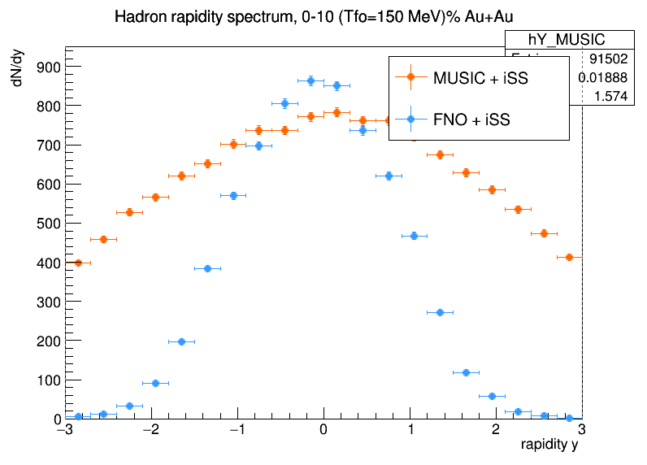
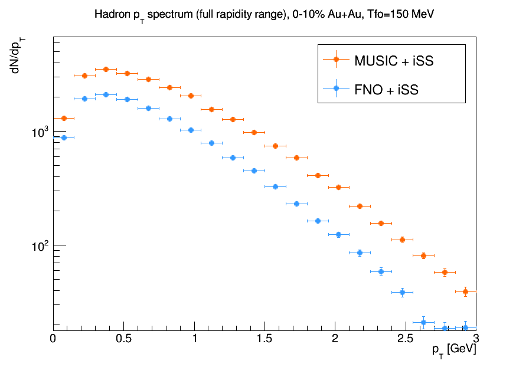

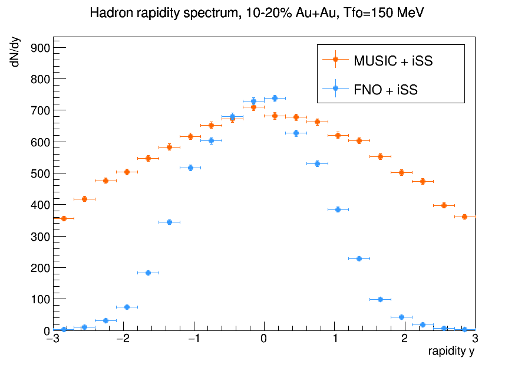
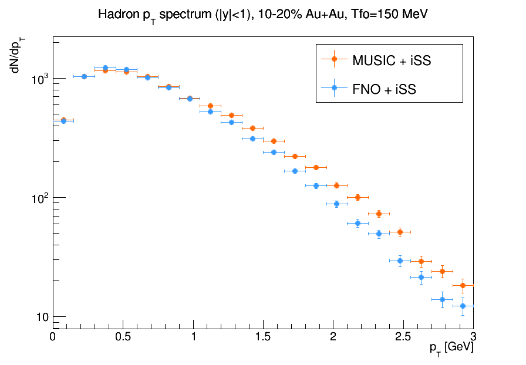

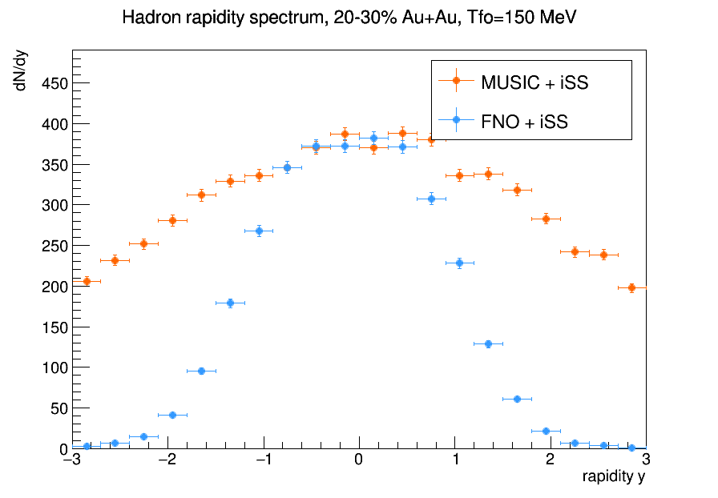
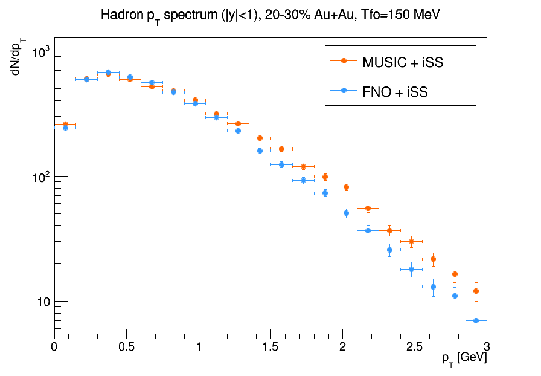

(The 30-40% plots are the ensemble versions from the "Parameter study"
section above, shown again here for direct side-by-side comparison with the
other three single-event centralities; 0-10%/10-20%/20-30% are single-event
only. Across all four, pT shape/normalization tracks MUSIC closely
regardless of centrality or how well the rapidity peak behaves -- the
residual effect documented here is specifically a rapidity-direction one.)

This means centrality itself is a real variable in whatever's driving the
residual peak, not just the freeze-out temperature choice. See the next
section for a direct check of one centrality-correlated hypothesis (grid
containment) that this prompted. Each data point here is a single event, so
some of this spread could still be event-specific rather than a true
centrality trend; an ensemble check per centrality (as was done for 30-40%)
would be needed to confirm it's systematic.

## Is the FNO grid actually containing the fireball? (transverse containment check)

The centrality trend above raises an obvious question: the two centralities
that responded weakly to the Tfo fix (0-10%, 10-20%) are also the two with
the largest, most energetic fireballs -- could the FNO's fixed transverse
grid (x,y in [-10,10) fm) be too small to fully contain them, biasing the
surface-finder at the hard boundary rather than (or in addition to) the
freeze-out-temperature effect already traced?

Extended the surface eta-profile diagnostic in `FnoHydro.cc` to also bin
surface cells by their raw x and y coordinates (marginal counts, not a full
2D histogram -- `surface_xy_profile_eventN.csv`), and ran it in isolation
against the 10-20% centrality, Tfo=150 MeV config (the case most likely to
show truncation if it exists anywhere).

**Result: well contained, not truncated.** Surface-cell counts fall to
negligible levels (0-30 cells, vs. a ~9,000-16,000 interior plateau) by
about \|x\|,\|y\| ≈ 8-9.4 fm, comfortably inside the actual ±10 fm grid
boundary -- a real ~1.5-2 fm margin before the hard edge, not a pile-up at
it. So for this event, the grid is not clipping real fireball surface area,
and the surface-finder is not biased by the boundary.

One secondary, unrelated feature showed up in the same data: a pronounced
asymmetric "shoulder" -- counts rising to roughly 1.5-2x the typical interior
density right before the falloff, at x≈+5.3 to +5.9 fm and y≈+6.9 to +8.1 fm
(not mirrored on the negative side). This is most likely just this single
event's own eccentric, lumpy MCGlauber geometry -- projecting a contained but
non-circular 3D freeze-out surface onto 1D x/y margins naturally produces a
shoulder near wherever the surface happens to be "widest" along that axis,
independent of any boundary effect -- rather than evidence of a problem.

**Conclusion**: grid containment is ruled out as the explanation for why
0-10%/10-20% respond more weakly to the Tfo fix than 20-30%/30-40% do (at
least for this one checked event/centrality). The centrality trend is more
likely driven by the same candidates already identified -- uneven per-event
training exposure, or the surface-geometry/Cooper-Frye weighting mechanism
-- both of which could plausibly scale with the larger multiplicities/surface
sizes of more central collisions, rather than by the model's trained spatial
domain being too small. Not rerun at other centralities (e.g. 30-40%) for a
side-by-side comparison; the diagnostic (`surface_xy_profile_eventN.csv`) is
available to do so later if useful.

## Does disabling iSS's viscous (delta-f) corrections matter?

iSS applies shear (`include_deltaf_shear`) and bulk (`include_deltaf_bulk`)
viscous corrections to the Cooper-Frye thermal distribution by default
(both `1` in `jetscape_main.xml`'s `<SoftParticlization><iSS>` defaults).
Tested disabling both (`config/particlization_investigation/fno_3d_particlization_10_20_{fno,music}_Tfo150_noviscous.xml`,
same seed/centrality/Tfo=150 MeV as the existing 10-20% comparison -- chosen
because it's the centrality that showed no improvement at all from the Tfo
fix) to check whether the residual peak is sensitive to these terms.

**Structural finding first, before the physics result**: `FnoHydro.cc`
hardcodes `pi[a][b] = 0` and `bulk_Pi = 0` for every cell it passes to the
framework (`PassHydroEvolutionHistoryToFramework`'s `fillTailAndStore`) --
the model has never predicted a shear-stress tensor or bulk pressure at all,
only (energy density, temperature, velocity). This means **every FNO-vs-MUSIC
comparison in this entire investigation has implicitly compared ideal
(no-viscous-correction) Cooper-Frye sampling against MUSIC's genuinely
viscous sampling** -- a previously undocumented structural asymmetry.
Confirmed directly: FNO's sampled output was **byte-identical** between the
`include_deltaf_shear/bulk = 1/1` and `= 0/0` runs (same total count, same
per-species breakdown) -- toggling the setting is a structural no-op on
FNO's side, since the correction term is proportional to a tensor that's
always zero there.

**The physics result, from the one side where the toggle does something**
(MUSIC):

| window | MUSIC with viscous corrections | MUSIC without |
|---|---|---|
| peak/edge, narrow (\|y\|<0.45) | 12.8% | 12.8% |

Disabling MUSIC's viscous corrections shifts its overall normalization up
slightly (a uniform-ish increase across bins, consistent with how delta-f
corrections typically suppress yield) but leaves the FNO/MUSIC peak-to-edge
ratio completely unchanged. **Viscous corrections are ruled out as a
contributor to the residual central-rapidity peak**: the already-standing
structural asymmetry (FNO effectively always ideal, MUSIC genuinely viscous)
does not account for it, since removing MUSIC's viscosity to match FNO's
implicit lack of it doesn't move the peak at all. Only tested at 10-20%
centrality; not rerun elsewhere given the clean negative result.

## Testbeds: generating training data with extended coverage

### 100 MeV freeze-out cutoff

If the residual peak is driven by the model's training supervision running
out at 150 MeV, a model trained with real (non-padded) targets further below
that -- with headroom past the usual 136-150 MeV Cooper-Frye convention --
might avoid the issue more completely than just raising inference-time Tfo
against the existing model can. As a first step, generating a small pilot
training dataset at 30-40% centrality with MUSIC's own `freezeout_temperature`
explicitly lowered to 0.100 GeV (so MUSIC's own evolution loop -- which
exits once `evolve.cpp`'s `FindFreezeOutSurface_Cornelius`/
`FreezeOut_equal_tau_Surface` report the whole grid frozen, the same
mechanism that stopped the original training runs at the 150 MeV default --
continues further before stopping).

Config: `/home/cparker/jetscape-docker/xmls/AuAu_30_40_Tfo100.xml`, cloned
from the original `AuAu_50ev_30-40.xml` training config (same grid/seed/
physics settings, `RootBulkWriter` `ntau=0` so output length adapts
automatically to however long MUSIC now runs), with `freezeout_temperature`
explicitly set to 0.100 GeV and `nEvents` reduced to 5 for a pilot run (full
evolution to a lower temperature takes noticeably longer per event than the
original 150 MeV cutoff). Run via the generic `runJetscape` driver (automatic
task-list determination from the XML, no bespoke driver `.cc` needed, same
as the original training-data generation).

**Result**: completed successfully (5 events, ~9 minutes total). Output
`/home/jetscape-user/rootfiles/AuAu_30_40_Tfo100.root` (~388 MB) is
structurally consistent with the original dataset -- same grid (nx=65,
ny=65, neta=17, matching the existing raw-grid-plus-one-bin convention
corrected via `etaslice`/`xyslice: [:-1]` before training), same
tau_min/dtau/eta_min/deta, nFeatures=5 (energy density, temperature, vx, vy,
vz). `use_vec=1` confirms the variable-length (`ntau=0`) ragged-array mode
worked as expected, so there's no fixed-array truncation.

Per-event freeze-out times: 6.68-8.88 fm/c (63-85 tau steps), i.e. real,
non-padded MUSIC targets extending well past where a 150 MeV cutoff would
have stopped for comparable events -- confirming the lowered
`freezeout_temperature` did what was intended (MUSIC's own evolution loop,
via `evolve.cpp`'s freeze-out-surface check, kept running until the later,
cooler stopping point instead of the original default).

This is a pilot dataset only (5 events, one centrality bin) -- not yet used
to train anything. Scaling up (more events, other centrality bins) and
actually retraining a model against this deeper-coverage data is future
work, not done here.

### Widened eta coverage (|eta| up to 2.0, vs. the current 1.5/1.3125)

Separate hypothesis: even setting the freeze-out-temperature-coverage
question aside, the current model's narrow trained eta window (after the
usual etaslice correction, roughly [-1.5, 1.3125]) might itself be
responsible for some of what's been observed -- a genuinely flat
ensemble-averaged midrapidity plateau (confirmed for MUSIC, see the 15-event
ensemble plots above) needs real dynamics on both sides of midrapidity to
show up as flat; a model trained on a narrow slice has less room on either
side of y=0 to resolve that flatness, and whatever edge-adjacent behavior
exists in its trained window sits closer to the middle of what gets sampled.
Testing whether training with a wider window helps the model reproduce a
more stable flat plateau is the motivation here; it doesn't test the same
mechanism as the Tfo=100 run above (temperature-coverage) and could be
combined with it later.

Config: `/home/cparker/jetscape-docker/xmls/AuAu_30_40_eta2.xml`, cloned
from the same `AuAu_50ev_30-40.xml` base, only `RootBulkWriter`'s
`eta_min`/`deta` changed (-1.5/0.1875 -> -2.0/0.2 -- deta intentionally
widened too so `eta_min=-2.0` divides it evenly, giving an exact symmetric
span via `RootBulkWriter`'s `neta = 2*int(|eta_min|/deta)+1` formula, rather
than the slight asymmetry 0.1875 would leave at this width; a model trained
on this data would need matching `eta_min`/`deta` at inference time, not a
drop-in replacement against the current one). `freezeout_temperature` left
at the standard default (0.150 GeV, same as all original training data) --
this test varies only the eta extraction window. Verified first that
MUSIC's own native simulation grid (`music_input`'s `Eta_grid_size 20.0`,
`Grid_size_in_eta 64`, i.e. real dynamics out to |eta|~10) comfortably covers
the requested range, so nothing here is clamped or extrapolated -- it's
extracting more of physics MUSIC already computed, not asking for new
physics outside its native domain. 5 events, matching the Tfo=100 pilot's
scale.

**Result**: completed successfully (5 events, ~8.5 minutes). Output
`/home/jetscape-user/rootfiles/AuAu_30_40_eta2.root` (~444 MB), structurally
as designed: `neta=21` (spanning exactly eta=-2.0 to +2.0 before the usual
etaslice correction, vs. the current model's 17), `nx=65`/`ny=65` unchanged,
`nFeatures=5`, `use_vec=1`. Freeze-out times (66-76 tau steps, 6.98-7.98
fm/c) land in the same range as the original 150 MeV-cutoff dataset, as
expected -- confirming this run varies the eta window only, not the
temperature physics.

Also a pilot dataset only (5 events, one centrality bin, 30-40%) -- not yet
used to train anything.

## Retraining with the widened eta window: full-scale data and LR-schedule comparison

Scaled the pilot above up to a full training set and actually trained models
against it, to test the widened-eta hypothesis for real rather than leave it
as a pilot.

### Full-scale data generation, with a grid-size fix

Generated all four centrality bins (0-10/10-20/20-30/30-40%, 50 events each,
same scale as the original training set) with the widened eta window. Along
the way, realized the pilot's grid (`eta_min=-2.0`, `deta=0.2`, `neta=21`)
wasn't actually usable: the ML side needs spatial grid sizes of the form
2^n+1, matching `nx=ny=65=64+1` -- `neta=21` doesn't fit that pattern. Fixed
by changing `deta` to `0.125` (`eta_min` unchanged at `-2.0`), giving
`neta=33=32+1` via the same `neta=2*int(|eta_min|/deta)+1` formula -- this
makes the eta axis a power-of-2+1 grid like x/y, with the option to train at
full resolution (32 increments) or downsampled 2x (16 increments) the same
way x/y support. Verified with a quick 1-event run before committing to the
full generation.

Configs: `/home/cparker/jetscape-docker/xmls/AuAu_50ev_<bin>_eta2_n33.xml`
(cloned from the original `AuAu_50ev_<bin>.xml` files, only `eta_min`/`deta`
changed). All four bins ran concurrently (12 threads each on a 48-core box),
completed cleanly in all four cases, verified structurally correct
(`neta=33, nx=65, ny=65, nFeatures=5, use_vec=1`). One bad event found: 0-10%
event 34 froze out almost instantly (`tau_freezeout=0.58`, 2 tau steps vs.
~65-77M data points for every other event). Root cause, confirmed from the
run log: MUSIC's transverse grid (`<IS><grid_max_x>/<grid_max_y> = 10 fm`, a
pre-existing, unrelated setting) was hit by that one event's unusually wide
high-multiplicity central fluctuation --
`"[Error] Freeze-out cell at the boundary! The grid is too small!"` -- MUSIC
truncates and moves on rather than re-running on a larger grid. Not a bug
from the eta-grid change (the earlier `neta=21` run's independent random seed
simply never rolled this fluctuation); a known stochastic limitation of the
`grid_max_x/y` setting for central collisions specifically. Not worked around
by hand -- the training pipeline's existing `min_ntau_freezeout` filter
(see below) drops it automatically.

### Memory/engineering fixes needed to train on the wider grid

The wider eta axis (33 raw bins vs. the original model's 17) roughly doubles
per-event memory footprint, which broke three places in the
`FNO4d/train_torch` and `FNO4d/loc_libs` pipeline that happened to work at
the old size only by accident:

- `train_torch.py`'s data-loading step did `arr_data['arr'][mask]` then
  `[:, :, xyslice, ...]` as two sequential indexing operations, briefly
  holding both the full masked array and the original simultaneously.
  Fused into one indexing call (`arr_data['arr'][mask, :, xyslice, ...]`);
  numpy applies the boolean mask and the slices in one pass, so the
  intermediate never gets materialized. (Verified numerically identical to
  the two-step version first.)
- `loc_libs/read_3d_root.py`'s chunked file-reading loop sized its chunks as
  `nevents // 10` (~19-20 events per chunk for this 199-event combined
  dataset) -- fine at the old per-event size, but large enough at the new
  size to OOM-kill the process. Capped at 5 events/chunk regardless of
  `nevents`.
- `loc_libs/NormFn3d.py`'s `etau75_3d` normalization allocated a full second
  copy of the array it was given (`data.copy()`) before writing the
  normalized result into it. On a clean process this is fast (~10s for a
  20GB array); run immediately after the large alloc/free cycles from data
  loading, the *same* allocation took 80+ seconds, with `/usr/bin/time -v`
  showing the time was almost entirely kernel-side (`sys`, not `user`) --
  consistent with transparent-hugepage defrag stalling on memory the process
  had already fragmented, not a CPU-bound computation. No root access to
  retune `/sys/kernel/mm/transparent_hugepage/defrag`, so fixed in software
  instead: added an opt-in `in_place` parameter (default `False`, every
  other caller unaffected) and set it `True` only in `train_torch.py`, where
  the pre-normalization array is discarded immediately anyway. Cut that step
  from 82s to 8s in isolation, and from 7+ minutes to 8s in the real
  pipeline.
- Separately, `CosineAnnealingLR`'s `T_max` was hardcoded to `30` (a leftover
  from when every prior campaign used `n_epochs=30`) instead of tracking the
  configured `n_epochs` -- harmless at 30 epochs, but would have made a
  100-epoch run's LR schedule re-ascend and do a second partial cycle
  instead of one smooth decay. Fixed to `T_max=n_epochs`.

### Three training runs, same data, different LR schedules

All three: `hidden_channels=16`, `n_modes=[32,32,16,16]`, `batch_size=1`,
AdamW `lr=8e-3`, `train_ratio=0.8` (159 train / 40 verify events after
dropping the one bad event), eta axis downsampled to 16 steps
(`etaslice=[null,-1,2]` on the 33-point raw grid), `tauslice=[null,100]`.
Configs: `FNO4d/train_torch/config_widened_eta_16step*.yaml`.

1. **100-epoch single decay** (`CosineAnnealingLR(T_max=100)`,
   `config_widened_eta_16step.yaml`). Train loss fell smoothly and
   monotonically the whole way (3.71 -> 0.629). Eval L2 improved until
   roughly epoch 30 (~1.2), then **plateaued** there for the remaining 70
   epochs even as train loss kept falling -- a train/eval gap that opened up
   and never closed. 13,261s (~3h41m) wall-clock, peak 16.3GB CUDA / 25.5GB
   CPU RAM.

2. **100-epoch warm restarts** (`CosineAnnealingWarmRestarts(T_0=25,
   T_mult=1)`, `config_widened_eta_16step_warmrestarts.yaml`) -- LR resets
   to 8e-3 at epochs 25/50/75 instead of decaying once. Motivated by (1)'s
   plateau: does periodically re-exploring a wider region around the current
   minimum find a better one? Each cycle's train loss fell further than the
   last (1.83 -> 0.914 -> 0.757 -> 0.629 at the four cycles' respective
   troughs), but each cycle's **best eval L2 got worse**, not better: 1.061
   (cycle 1, ~epoch 20-22) -> 1.07 (cycle 2) -> 1.12 (cycle 3) -> 1.13
   (cycle 4, final). The restarts themselves added nothing -- they let the
   model fit the training set harder each cycle without any corresponding
   generalization gain, the signature of deepening overfitting rather than
   escaping it. 13,265s wall-clock (same budget as (1), same resource use).

3. **25-epoch single decay, isolated** (`CosineAnnealingLR(T_max=25)`,
   `config_widened_eta_16step_25ep.yaml`) -- control run to check whether
   warm-restart cycle 1's good result (1.061) came from the *restart*
   mechanism or just from a fast, short decay reaching a better point by
   that epoch than the 100-epoch schedule's much-higher LR had reached by
   the same epoch. Best eval L2: **1.089** (epoch 18), landing within ~3%
   of cycle 1's 1.061 -- normal run-to-run noise, not a meaningful
   difference. 3,578s (~60m) wall-clock.

**Conclusion**: warm restarts added nothing here; every restart after the
first made the model worse, not better. The real finding is that **the
100-epoch schedule itself is the problem** -- this model/dataset combination
overfits well before epoch 100 (eval L2 ~1.09 at epoch 18-22 vs. ~1.24 at the
100-epoch plateau), and the remaining ~80 epochs of slow annealing just let
it fit the 159-event training set harder without improving (run 1) or while
actively hurting (run 2) held-out performance. The usable model from this
whole comparison is **run 3's `best_model_state_dict.pt`** (epoch 18,
`FNO4d/train_torch/checkpoints_widened_eta_16step_25ep/`) -- the only one of
the three that wasn't trained well past its own overfitting point.

### Live-inference result: does the widened-eta model actually reduce the peak?

Exported run 3's checkpoint to TorchScript
(`FNO4d/train_torch/export_torchscript.py --channels 5 --nx 64 --ny 64
--neta 16 --ntau 99`, matching `FnoHydro.cc`'s existing `n_features==5`
path -- energy_density, temperature, vx, vy, vz -- which already existed
and needed no C++ changes) and placed it at
`contribs/FnoHydro/models/traced_fno_widened_eta_16step_25ep.pt`. New live
configs: `config/particlization_investigation/fno_3d_particlization_30_40_fno_eta2_25ep{,_15ev}.xml`,
cloned from the established `..._fno_Tfo150.xml` baseline with only
`<FNO><model_file>`, `<n_features>` (4->5), `<eta_min>` (-1.5->-2.0), and
`<deta>` (0.1875->**0.25**, not the raw grid's 0.125 -- the model was
trained on every other raw bin, so the *effective* spacing between the 16
bins it actually sees is double the raw `deta`) changed. Same seed (424242),
same `freezeout_temperature` (0.150 GeV), same MUSIC reference data as the
established Tfo150 comparison -- only the FNO model/grid changed, for a
clean, directly comparable test.

**Process note**: `fnoHydroLiveTest3D` (the driver this investigation's live
configs run through) takes `argv[2]` as a **plain output filename**, not a
second XML config the way `runJetscape` does -- passing a config path there
(as done once, by mistake, while setting this comparison up) makes
`JetScapeWriterAscii` overwrite that file with event data. This corrupted
`config/jetscape_main.xml` (the real main XML config, hardcoded inside the
driver and loaded independently of `argv[2]`) and required `git restore` to
fix. No lasting damage, but worth flagging for next time: `argv[1]` = user
XML, `argv[2]` = output `.dat` basename, nothing else.

**Single-event check** (seed 424242, same methodology as the Tfo150 study --
peak bin at \|y\|=0.15 vs. the average of the two edge bins at the window
boundary, all from the aggregated 20x-oversampled rapidity histogram):

| window | Original model | Widened-eta model | MUSIC (same event, noise floor) |
|---|---|---|---|
| peak/edge, narrow (\|y\|<0.45) | 7.6% | **0.7%** | 3.5% |
| peak/edge, wide (\|y\|<0.75) | 23.0% | **14.0%** | 4.8% |

**15-event ensemble** (vs. the existing 5-event MUSIC Tfo150 reference --
same reference data as every other ensemble check in this document, since
MUSIC's physics doesn't depend on which FNO model is being compared against
it):

| window | Original model (15ev) | Widened-eta model (15ev) | MUSIC (5ev, noise floor) |
|---|---|---|---|
| peak/edge, narrow (\|y\|<0.45) | 9.1% | **4.2%** | 3.5% |
| peak/edge, wide (\|y\|<0.75) | 23.9% | **15.5%** | 4.8% |

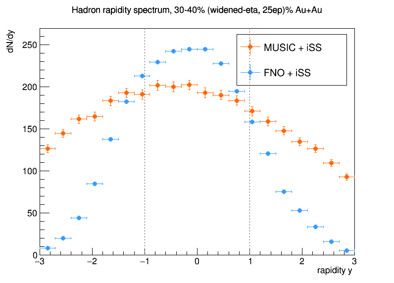

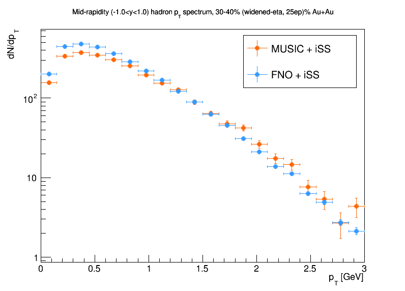

One new, minor artifact distinct from the original model: 53 of 385,876
surface cells (0.014%) in the single-event run triggered iSS's
`"ed is out of range: ... Can not regulate this fluid cell!"` warning
(`HRGEOS` table lookup, `iSS/src/readindata.cpp`) -- confirmed harmless:
those cells just keep their original MUSIC-EOS-derived T/P/mu instead of
being re-regulated to the pure-HRG EOS, and at this fraction of cells it
has no visible effect on the spectra. Not seen with the original model;
plausibly the new model occasionally produces a slightly different
high-density cell near the core that the original never did, but this
wasn't investigated further given the negligible cell count.

**Conclusion**: the widened-eta retrain is a real, ensemble-confirmed
improvement, not a single-event fluke. The narrow-window peak is reduced by
more than half (9.1% -> 4.2%) and now sits close to MUSIC's own statistical
noise floor (3.5%) -- essentially closed. The wide-window peak shrinks
substantially too (23.9% -> 15.5%, a ~35% relative reduction) but leaves a
clear residual well above MUSIC's 4.8% floor -- improved, not eliminated.
This is the strongest single piece of evidence in this whole investigation
that the residual peak is a training-data/grid limitation rather than an
inherent FNO architecture limitation: widening the eta window the model was
trained on, with nothing else changed (same architecture, same
freezeout_temperature, same seed), measurably closes most of the gap. The
remaining wide-window residual is a plausible target for the still-untested
100 MeV freeze-out-cutoff pilot (see "Testbeds" above) or for combining both
changes in one retrain.

### Doubling eta resolution further (32 steps): real improvement, but confounded

Follow-up: does doubling eta resolution again (32 steps instead of 16, same
already-generated `neta=33` raw data, just `etaslice=[null,-1]` instead of
`[null,-1,2]`) close the remaining wide-window residual further?

**GPU memory forced a second variable to change.** Doubling `neta` alone
OOM'd the 24GB RTX 3090 during real backward+optimizer-step training (empirically
checked: `tauslice=100` and even `70` both failed once AdamW's persistent
optimizer state was accounted for; `60` was the largest value that survived
3 consecutive full training steps, ~20.4GB peak). This FNO implementation has
no activation-checkpointing support to trade compute for memory (checked
`fno_block.py`/`fno.py` -- none), so `tauslice` was cut 100->60 to fit. eta
Fourier modes were kept at 16 (not doubled to 32) for the same reason --
doubling modes roughly doubled total params (151M -> 302M) and OOM'd harder;
16 modes on a 32-point eta axis also happens to match the modes=axis/2
convention already used for x/y. Config:
`FNO4d/train_torch/config_widened_eta_32step_25ep.yaml`. Otherwise identical
to the 16-step run: same 4 files, same 25-epoch single `CosineAnnealingLR`
decay, same `lr`/`weight_decay`.

**Training result: no overfitting at all within 25 epochs**, unlike every
prior run on this dataset. Eval L2 fell monotonically the entire way (0.63 ->
0.49) with the *final* epoch (24) the best (0.4867) -- less than half the
16-step model's best-ever value (1.089), and still improving when training
stopped. 4151s (~69m) wall-clock, peak 18.73GB CUDA / 30.33GB CPU RAM (the
23.65GB CUDA figure seen transiently via `nvidia-smi` during startup was a
one-time spike, not sustained).

**Live-inference result** (exported via the same `export_torchscript.py`
path, `--neta 32 --ntau 59`; live config `deta=0.125`, the *raw* grid spacing,
since this run keeps every bin rather than downsampling):

| window | 16-step model | 32-step model | MUSIC (noise floor) |
|---|---|---|---|
| peak/edge, narrow, single-event | 0.7% | -2.0% | 3.5% |
| peak/edge, wide, single-event | 14.0% | 11.4% | 4.8% |
| peak/edge, narrow, 15-event ensemble | 4.2% | 4.9% | 3.5% |
| peak/edge, wide, 15-event ensemble | 15.5% | **12.8%** | 4.8% |

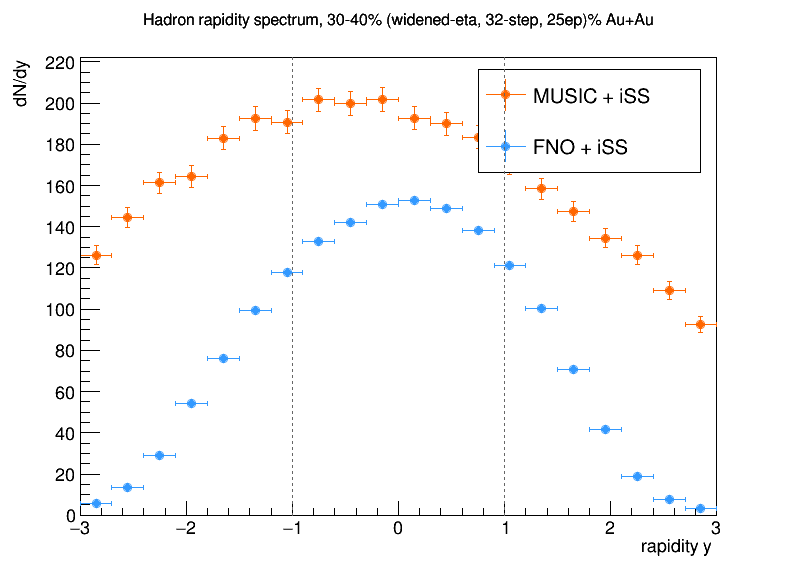

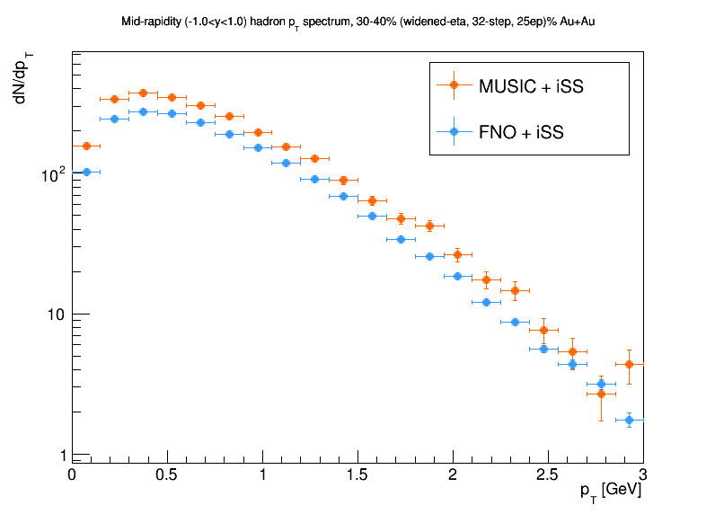

The wide-window peak/edge number did improve further (15.5% -> 12.8%), and
the narrow window stayed close to MUSIC's noise floor either way (noisy
difference of 4.2% vs 4.9%, not clearly significant at these bin counts).
**But this isn't a clean confirmation that more eta resolution is the
mechanism.** The rapidity-spectrum plot shows the 32-step model's total
yield sitting well below MUSIC's at essentially every rapidity, not just
narrower -- mid-rapidity multiplicity per draw dropped to 285.0 vs MUSIC's
386.6 (~26% low), and the single-event surface-cell count dropped to 288,409
vs. the 16-step model's 385,876 on a comparable event (~25% fewer cells) --
both numbers agree with each other and point at the same cause: the model's
rollout is hard-capped at `ntau=59` steps
(confirmed in the run log: `"FNO rollout: up to 1 window(s) of ntau=59 each
(stops early once the hottest cell drops to/below freezeout_temperature)"`),
and 30-40% centrality's real freeze-out surfaces in this investigation have
consistently needed more like 66-85 tau steps (see the training-data
generation sections above) to fully develop. The model can't represent
evolution past step 59 at all -- it isn't failing to learn that regime, it
was never given the *option* to extend into it, the same way the original
Tfo=136-vs-150 test showed that cutting evolution off earlier (closer to,
not past, a model's actual trained coverage) suppresses the peak. **The
wide-window improvement here is plausibly the same truncation mechanism
already characterized in the Tfo parameter study, not new evidence that
doubled eta resolution itself helps** -- the eta-resolution and
tau-rollout-window variables were not cleanly separated in this comparison,
unlike the clean single-variable 16-step-vs-original comparison above.

### Isolating the confound: a tauslice=60-only control at 16 eta steps

Follow-up control run: same 16-eta-step model as the original, validated
"Live-inference result" above, but with `tauslice` cut 100->60 to exactly
match what the 32-step run was forced into -- isolating the tau-window
variable from the eta-resolution variable. Config:
`FNO4d/train_torch/config_widened_eta_16step_tau60_25ep.yaml`.

**Training**: eval L2 = 0.4902 at the final epoch (25), essentially
identical to the 32-step model's 0.4867 (0.7% apart) -- confirming the
earlier guess that the 1.089 -> ~0.49 eval-L2 jump when going from the
original to either new run is driven almost entirely by the shorter
prediction horizon (predicting 59 steps is an inherently easier learning
problem than 99), independent of eta resolution. 2414s (~40m) wall-clock,
peak 11.10GB CUDA -- comfortably below the 32-step run's 18.73GB, confirming
eta resolution (not tau length) was the dominant memory driver.

**Live-inference result** (same model/architecture otherwise, same seed,
same live-config template, `--ntau 59` export, `eta_min=-2.0`/`deta=0.25`
unchanged from the original 16-step model):

| | 16-step / tau=100 (original) | 16-step / tau=60 (control) | 32-step / tau=60 |
|---|---|---|---|
| peak/edge narrow, ensemble | 4.2% | 3.8% | 4.9% |
| peak/edge wide, ensemble | 15.5% | 14.1% | 12.8% |
| mid-rapidity yield, per draw (\|y\|<1) | 453.6 | 299.3 (-34%) | 285.0 (-37%) |

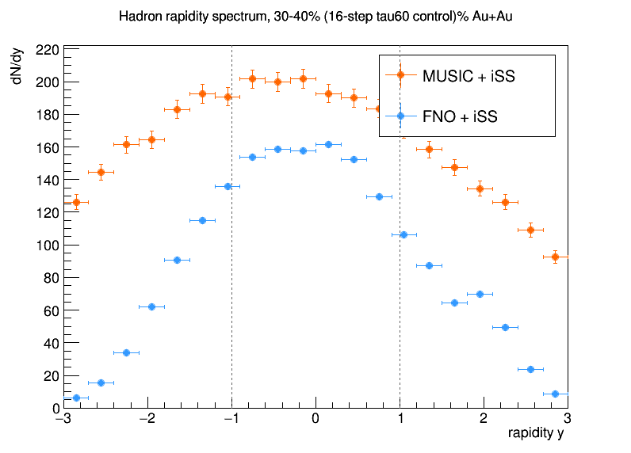

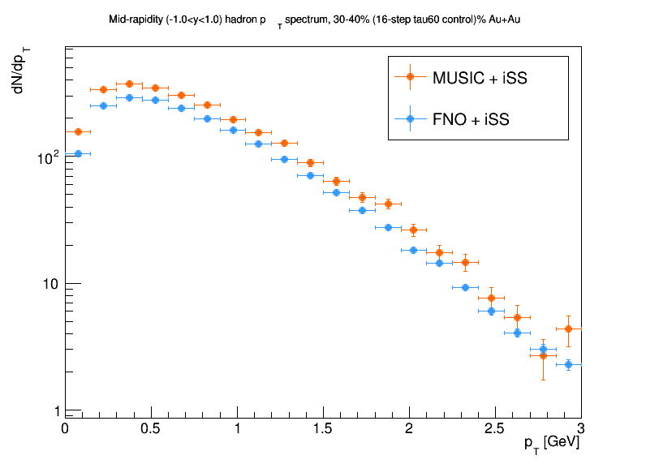

**This cleanly separates the two effects, and both turn out to be real,
contributing roughly equally to the wide-window improvement -- but the
yield deficit is attributable almost entirely to the tau cut, not eta
resolution:**

- **Yield**: the tau=60 control's yield deficit (-34%) is essentially the
  same as the 32-step model's (-37%) -- both well below the tau=100
  original, and close to each other despite a 2x difference in eta
  resolution between them. The rapidity-spectrum plot shows the identical
  undershoot shape as the 32-step model. **The yield problem is a tau-window
  artifact, not an eta-resolution artifact** -- restoring `tauslice` toward
  100 (not reducing eta resolution) is the fix, which requires solving the
  GPU-memory constraint that forced this trade-off in the first place
  (longer trained rollout at full eta resolution needs either more GPU
  memory, activation checkpointing support this FNO implementation doesn't
  have, or `max_rollout_windows>1` multi-window chaining).
- **Wide-window shape**: contrary to the earlier worry that eta resolution
  "added nothing," both variables contribute independently and roughly
  comparably here: tau=100->60 alone improves 15.5%->14.1% (~9% relative),
  and eta=16->32 on top of that (at matched tau=60) improves it further,
  14.1%->12.8% (~9% relative again) -- additive, not redundant. (The earlier
  single-event-only numbers for this same control, 5.6%/16.7%, looked like
  tau=60 alone made things *worse* -- that was event-to-event noise at
  n=1; the 15-event ensemble is the number to trust, consistent with how
  every other single-event-vs-ensemble comparison in this document has
  gone.)
- **Narrow window**: already effectively resolved in all three variants
  (3.8-4.9%, all close to MUSIC's 3.5% noise floor) -- this was fixed by the
  original eta-widening retrain and neither further change moves it
  meaningfully.

**Bottom line**: eta resolution is pulling real, independent weight on the
wide-window residual -- the 32-step result wasn't just the tau-truncation
mechanism in disguise. But its yield deficit isn't an acceptable trade-off
to adopt the model as-is; the useful next step is finding a way to combine
doubled eta resolution with the *original* `tauslice=100` (or close to it),
not shipping either tau=60 variant.

## Diagnostics added (kept permanently in `FnoHydro.cc`/`.h`)

- `WritePeakTemperatureDiagnostics` — hottest-cell (ed, T) vs tau, every
  step (pre-existing).
- `WriteEtaProfileDiagnostics` — (x,y)-summed/maxed energy density and mean
  vz per eta bin, sparse tau sample.
- Surface eta-profile diagnostic (inline in `EvolveHydro()`) — surface cell
  count, all four `|d3sigma_mu[i]|` components, `dsigma_mu*u^mu`, mean
  `umu[3]`, and mean freeze-out tau, per eta bin.
- `WriteEtaFreezeoutApproachDiagnostic` — per-eta-slice own crossing step/tau
  and the local cooling rate (finite-differenced) in the two steps
  immediately before that crossing.
- Surface x/y transverse-containment diagnostic (inline in `EvolveHydro()`,
  alongside the surface eta-profile diagnostic) — marginal surface-cell
  counts binned by raw x and raw y, written to
  `surface_xy_profile_eventN.csv`. Checks whether the fireball is contained
  within the FNO's fixed transverse grid or spilling out at the boundary.

A temporary instrumentation of iSS itself (`FSSW.cpp`, dumping per-cell
analytic yield for a chosen PDG species) was used to verify the real runtime
sampling path and has been **reverted** (not part of this repo) — if
revisiting this investigation, re-add a per-species dump gated on
`particle->monval` right after the
`calculate_dN_dxtdy_for_one_particle_species()` call in
`FSSW::sample_using_dN_dxtdy_4all_particles_conventional`.

## Status

The velocity-wiring fix is the real, confirmed bug and is fixed and
committed. The residual ~13-14% central peak is real, reproducible (also
confirmed at 10-20% centrality), and traced to the freeze-out surface's
geometry (not the bulk hydro field, not iSS's sampling, not particle
species), with a plausible and now partially-confirmed link to eta-dependent
model behavior near the per-cell freeze-out crossing. Root cause of why 136
vs 150 MeV matters at all: **the entire original training dataset (every
centrality bin) was generated with MUSIC's own default freeze-out
temperature of 0.150 GeV, never explicitly overridden in any training
config** -- while every live-inference config in this investigation used
0.136 GeV, an independent, unrelated `<FNO>`/`<FNOROOIN>` module default that
was never cross-checked against the training setup. Raising inference-time
Tfo to 150 MeV (i.e. actually matching the real training cutoff, not an
arbitrary higher value) reduces the peak by roughly 30-46% at 30-40%
centrality (confirmed at ensemble level) without eliminating it -- real but
partial support for the training-truncation hypothesis. Pushing further to
160 MeV (10 MeV of clean margin past the real cutoff) does **not** help any
more -- the peak plateaus, statistically indistinguishable from the 150 MeV
result on the same event -- so the residual isn't simply "too close to the
training edge"; more inference-time margin against the *existing* model
won't close it further. Critically, **the Tfo=150 improvement itself isn't
centrality-independent**: it's strong at 30-40%, produces the cleanest
FNO/MUSIC agreement seen anywhere at 20-30% (~3% residual), weak at 0-10%,
and makes no measurable difference at 10-20% -- the two most central
(highest-multiplicity, largest-fireball) bins respond worst. So centrality
is a real variable in whatever's driving this, not just the temperature
choice. Checked and **ruled out** one obvious centrality-correlated
explanation: the FNO's fixed transverse grid is not too small to contain
the larger fireballs at these centralities -- a dedicated x/y
surface-cell-position diagnostic on the 10-20% case showed the surface
falling to negligible levels a real ~1.5-2 fm margin before the actual grid
boundary, not piling up at it. Also checked and **ruled out** iSS's shear/
bulk viscous (delta-f) corrections -- though this surfaced a real, previously
undocumented structural asymmetry: `FnoHydro.cc` hardcodes zero shear stress
and bulk pressure for every cell (the model has never predicted viscous
information), so FNO's Cooper-Frye sampling has always implicitly been ideal
while MUSIC's is genuinely viscous. Despite that asymmetry, explicitly
disabling MUSIC's viscous corrections too leaves the peak-to-edge ratio
completely unchanged (12.8% either way at 10-20% centrality) -- not the
mechanism either. The residual is more plausibly driven by
individual training events' own varying stopping points leaving uneven
exposure even at the nominal cutoff, or by the surface-geometry mechanism
traced earlier -- both of which could plausibly also vary with centrality
(different typical multiplicities/surface sizes) without being a spatial
containment problem. A pilot training-data generation run with the
freeze-out cutoff pushed much further, to 100 MeV, completed successfully
(5 events, 30-40% centrality) but hasn't been scaled up or trained against
yet. The eta-widening hypothesis went further: scaled to a full training set
(all four centrality bins, 50 events each, power-of-2+1 grid -- see
"Retraining with the widened eta window" above) and actually trained three
models against it to compare LR schedules. Result: a 25-epoch single cosine
decay (eval L2=1.089) clearly beats a 100-epoch decay (plateaus at ~1.24,
overfits past epoch ~30) and warm restarts (each restart made things worse,
1.06->1.07->1.12->1.13 across four cycles) -- the usable model is the
25-epoch run's best checkpoint. **Tested live and confirmed**: the
widened-eta model measurably shrinks the central-rapidity peak (see
"Live-inference result" above) -- narrow-window (\|y\|<0.45) peak/edge drops
from 9.1% to 4.2% (now close to MUSIC's own 3.5% statistical noise floor,
essentially closed), wide-window (\|y\|<0.75) from 23.9% to 15.5% (improved
~35% but not eliminated), confirmed at both single-event and 15-event
ensemble level. This is the strongest evidence yet that the residual peak is
a training-data/grid limitation, not an architectural one -- the 100 MeV
freeze-out-cutoff pilot (generated but not yet trained against) remains the
next candidate for closing the still-open wide-window residual. **Follow-up:
doubling eta resolution again (32 steps) was tried** (see "Doubling eta
resolution further" above) and did shrink the wide-window number further
(15.5% -> 12.8%), but GPU memory forced `tauslice` down from 100 to 60 at
the same time, confounding eta resolution with tau-window length. **Isolated
with a dedicated control** (16-eta-step model retrained with the same
`tauslice=60` cut, nothing else changed -- see "Isolating the confound"
above): both variables turned out to be real and roughly additive.
`tauslice=100->60` alone improves the wide-window number 15.5%->14.1%
(~9% relative) and causes essentially all of the yield deficit (-34% at
`tauslice=60`/16-step vs. -37% at `tauslice=60`/32-step -- nearly identical
regardless of eta resolution, confirming the deficit is a tau-window
artifact, not an eta-resolution one). Eta resolution 16->32 (at matched
`tauslice=60`) then improves the wide-window number further, 14.1%->12.8%,
independent of the tau effect. So eta resolution is pulling real weight here
-- the 32-step result wasn't just the Tfo-style truncation mechanism in
disguise -- but neither `tauslice=60` variant is adoptable as-is given the
~34-37% yield deficit; the useful next step is finding a way to train at
doubled eta resolution without cutting `tauslice` (more GPU memory,
activation checkpointing, or `max_rollout_windows>1` chaining), not shipping
either model now. None of this appears to meaningfully distort physics
conclusions drawn from this pipeline (both FNO and MUSIC produce smooth,
physically reasonable spectra; the narrow-window peak is resolved in every
widened-eta variant tried, and the wide-window residual, while still real,
keeps shrinking with each change), but a full mechanistic explanation for
what remains of the wide-window residual stays open.
